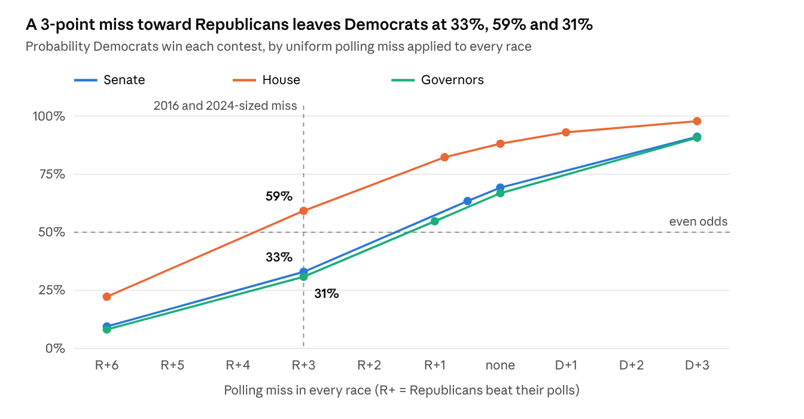

# A Transparent Poll-Based Forecast of the 2026 U.S. Midterm Elections

*Senate, House and gubernatorial forecasts from individual polls, a weak fundamentals prior and correlated polling error, with an audit of agent-collected data*

Tapas Roy · October 26, 2026 · Working paper, pre-election version

## Abstract

We present a fully specified, reproducible probabilistic forecast of the 2026 U.S. Senate, House and gubernatorial elections, published eight days before the November 3 vote. The forecast is built from 837 individually recorded polls (328 Senate, 224 House, 285 gubernatorial), each counted once and weighted by recency, sample size, population and sponsorship. A weak fundamentals prior anchored on the 2024 presidential margin is blended with the poll average by precision, and outcomes are simulated with correlated national, regional and race-level Student-$t$ errors whose scales are calibrated on historical poll error.

As of October 25, 2026 the model gives Democrats a 69% chance of Senate control (28% Republican, 3% held by unaligned independents), an 88% chance of a House majority (expected 233 seats, 80% interval 216 to 252), and a 67% chance of holding 26 or more governorships. Uniform polling-miss scenarios show that a 3-point Republican-leaning miss, the size seen in 2016 and 2024, makes Republicans favored to keep the Senate (Democrats 33%) and the governor majority (Democrats 31%).

The work makes two contributions beyond the forecast itself. First, it replaces a judgment-based first version with a rule-based model in response to a structured critique, and documents how the calls changed. Second, it audits poll and candidate data gathered by large-language-model research agents, finding two fabricated polls and several false factual claims, which we report as evidence on the reliability of agent-assisted data collection. We pre-register a post-election evaluation.

**Keywords:** election forecasting, poll aggregation, correlated error, calibration, LLM-assisted research, reproducibility

## 1. Introduction

Public election forecasts are now routine, but their methods are often partly opaque, and many informal forecasts still rest on judgment calls dressed as analysis. This paper documents a forecast whose every input and parameter is written down, whose code runs end to end from a poll file to a published page, and whose probabilities can be checked against outcomes after November 3, 2026.

The project began as a judgment-based sheet. Each race was called by rule: a leader with a polling margin above 10 points was called confidently, and closer races were decided by a "deep dive" into primary margins, history and local issues. An external review of that first version identified five problems:

1. Historical polling-error adjustments were applied inconsistently, and every one moved close races toward Republicans.
2. Polling aggregators were treated as independent evidence alongside the polls they aggregate.
3. Primary margins were used as if they predicted general-election results.
4. The 10-point cutoff created artificial confidence on one side of the line and none on the other.
5. Uncertainty across races was treated as independent, when polling errors are strongly correlated.

The rebuilt model addresses each point. Polls enter once, individually. State-specific "polls underestimate Republicans here" tilts are removed, because a state's past polling miss predicts its next one only weakly. Primary results and local issues are kept on the page as context but are not model inputs. The cutoff survives only as a flag for which races receive a manual review, narrowed on October 29 from 10 points to 6. Correlated error is simulated directly.

Our contributions are:

- A transparent three-chamber forecast with calibrated, correlated uncertainty and explicit handling of independents, ranked-choice voting and one-party ballots.
- A before-and-after record of how removing judgment tilts changed the calls: four Senate races (Iowa, Kansas, Maine, Texas) and nine House districts changed projected leader.
- An audit of agent-collected election data, reporting fabricated polls and false claims found before publication.
- Interactive sensitivity tools that let a reader impose a polling miss, rescale uncertainty, or fix the outcome of close races and see control probabilities recomputed under the same random draws.
- A pre-registered evaluation plan.

## 2. Related work

**Poll aggregation and dynamic models.** Linzer (2013) combined state polls with a structural prior in a dynamic Bayesian model of presidential vote intention. Heidemanns, Gelman and Morris (2020) extended that line with correlated state errors for *The Economist*. FiveThirtyEight's published methodology (Silver, various years) popularized pollster weighting, house-effect adjustment and simulation with correlated errors for congressional races. Our model is deliberately simpler than these: it uses a closed-form weighted average rather than a latent time series, and a one-step precision blend rather than full Bayesian updating. In exchange, every step can be audited by hand.

**Polling error.** Shirani-Mehr, Rothschild, Goel and Gelman (2018) showed that total survey error in election polls is roughly twice the reported sampling error, and that errors are correlated within an election. Jennings and Wlezien (2018) documented polling errors across countries and decades, finding no secular trend. The AAPOR evaluation of 2016 (Kennedy et al., 2018) attributed much of that year's miss to late shifts and the under-weighting of non-college voters. These results motivate our three-level error structure and our refusal to assume a fixed partisan direction of bias.

**Fundamentals.** Structural models of congressional and presidential outcomes use national conditions, presidential approval and incumbency (for example Abramowitz's work on the generic ballot). We use the simplest version of this idea: the 2024 presidential margin in each state or district, shifted by the national swing implied by the generic congressional ballot, plus an incumbency term.

**LLM-assisted research.** A growing literature reports that large language models fabricate citations and facts at non-trivial rates. We are not aware of published audits of LLM agents used to collect election polling data. Section 8 offers a small case study.

## 3. Data

The forecast uses 837 general-election polls, of which 828 enter a model average; the other nine are in House races already decided by the ballot (one party absent, or a same-party top-two in California).

| Chamber | Races | Polls recorded | Polls used | Verified at source | Campaign- or party-sponsored | One-party pollster, unsponsored | Likely-voter |
| --- | --- | --- | --- | --- | --- | --- | --- |
| Senate | 35 | 328 | 328 | 62 | 48 | 156 | 302 |
| House | 435 (168 audited, 109 polled) | 224 | 215 | 98 | 130 | 17 | 203 |
| Governor | 36 | 285 | 285 | 139 | 36 | 53 | 251 |

**Collection.** Polls were gathered by LLM research agents working state by state under a written protocol, then merged by script. The protocol required one record per poll, never an aggregator average; the likely-voter version when both were published; fieldwork dates, sample size and population; the sponsor; and a source URL. Polls ending on or after August 1, 2026 were collected, with earlier 2026 polls added where a race had fewer than three. A poll is marked *verified* only when its numbers were seen in the original release or a reputable outlet's report of it; numbers seen only in a secondary polling table are kept but down-weighted.

**Ballot and fact audit.** For every Senate and governor race, and for 168 competitive or polled House districts, agents recorded the exact general-election ballot, incumbency status, withdrawals, ranked-choice and runoff rules, and the three to six factual claims most likely to change a reader's view, each marked CONFIRMED, UNCONFIRMED or FALSE with a source. Section 8 reports what the audit found.

**Fundamentals.** For each race we record the 2024 presidential margin (on the 2026 district lines for the House, which in several states were redrawn mid-decade) and the most recent result for the office. The national swing is the October 2026 generic-ballot average (D+8.7) minus the 2024 national presidential margin (R+1.5), giving a shift of 10.2 points toward Democrats.

**Calibration data.** Error parameters were estimated from FiveThirtyEight's public historical poll files (raw polls 1998 to 2024 and the historical generic-ballot series) and from district results 2016 to 2024; Section 5 gives the estimates.

**Context not used.** Primary margins, ratings from Cook, Sabato and Inside Elections, and local issues were collected and are displayed, but are not model inputs.

## 4. Model

All margins are the Democrat (or main anti-Republican challenger) minus the Republican, in percentage points. The model has four steps: a weighted poll average, a fundamentals prior, a precision-weighted blend, and a correlated simulation.

### 4.1 Poll average

Each poll $i$ in race $r$ receives a weight

$$
w_i = 2^{-a_i/h} \cdot \sqrt{\min(n_i,\, n_{\max})} \cdot \pi_i \cdot s_i \cdot v_i \cdot \rho^{k_i} \tag{1}
$$

where $a_i$ is the poll's age in days at the as-of date; $h$ the recency half-life (14 days for Senate and governor races, 21 for the House); $n_i$ the sample size, capped at $n_{\max}$ (1,500 statewide, 1,000 district); $\pi_i$ the population factor (likely voters 1, registered voters and adults lower); $s_i = 0.5$ for campaign- or party-sponsored polls; $v_i = 0.85$ for polls not verified at source; and $\rho^{k_i} = 0.35^{k_i}$ down-weights a pollster's release that has $k_i$ newer releases in the same race, so that frequent pollsters do not dominate.

Before averaging, sponsored polls are shifted against their sponsor by $\delta_s$ (3.5 points Senate, 4.5 House, 4.0 governor), and unsponsored one-party pollsters by 1.5 points. The race average $\bar m_r$ is the weighted mean of adjusted margins, and the effective number of polls is the Kish quantity

$$
n_{\text{eff}} = \frac{\left(\sum_i w_i\right)^2}{\sum_i w_i^2}. \tag{2}
$$

Ranked-choice races use a pollster's final-round numbers where published; otherwise minor candidates' first preferences are transferred by fixed shares.

### 4.2 Fundamentals prior

The prior is the 2024 presidential margin $p$ shifted by the national swing $S = 10.2$, plus incumbency $I$ ($+1$ for a Democratic incumbent, $-1$ for a Republican, $0$ for an open seat). It differs by office:

- **Senate:** $\mu^{\text{prior}} = p + S + 2I$.
- **House:** $\mu^{\text{prior}} = p + (S - 1.0)\,e + \text{inc}$, where the $-1.0$ shades the generic ballot for its history of overstating Democrats, and $e = 1 - 0.25 \cdot \min(|p|, 40)/40$ damps the swing in lopsided seats. Incumbency is 3 points (halved on mostly new territory), plus half of the member's own 2024 over- or under-performance when the 2024 race was on comparable lines.
- **Governor:** Governors run far from their party's presidential vote, so the state lean is shrunk to 0.75, the national swing to 0.55, and incumbency is large:

$$
\mu^{\text{prior}} = 0.8\,\big[-1.5 + 0.75\,(p + 1.5) + 0.55\,S + 8I\big] + 0.2\,\big[g_{\text{last}} + 0.55\,\Delta_{\text{since}}\big] \tag{3}
$$

where $g_{\text{last}}$ is the last governor margin and $\Delta_{\text{since}}$ the national swing since that election.

Races whose main challenger is an independent (Nebraska, South Dakota, Idaho and Montana Senate; Alaska's at-large House seat; Rhode Island governor) have no meaningful D-versus-R prior and use polls only, with an extra 2.5 points of error.

### 4.3 Blend

The poll average carries a standard deviation

$$
\sigma_{\text{poll}}^2 = \sigma_{\text{state}}^2\,(1 + \lambda d) + \frac{\sigma_{\text{single}}^2}{n_{\text{eff}}} + (\gamma U)^2 \tag{4}
$$

where $d$ is days to the election, $U$ the average undecided share, and the remaining symbols are calibrated in Section 5. Polls and prior are combined by inverse-variance weighting,

$$
\mu_r = \frac{\bar m_r/\sigma_{\text{poll}}^2 + \mu_r^{\text{prior}}/\sigma_{\text{prior}}^2}{1/\sigma_{\text{poll}}^2 + 1/\sigma_{\text{prior}}^2}, \qquad \sigma_r^2 = \frac{1}{1/\sigma_{\text{poll}}^2 + 1/\sigma_{\text{prior}}^2}, \tag{5}
$$

so the prior matters only where polling is thin. A race with no polls uses the prior alone with its own, wider standard deviation.

### 4.4 Simulation

Each simulated election draws one national error $N$, one error $R_g$ per census region, and one race error $\varepsilon_r$:

$$
M_r = \mu_r + N + R_{g(r)} + \varepsilon_r, \qquad N \sim \sigma_N\, t_\nu,\quad R_g \sim \sigma_R\, t_\nu,\quad \varepsilon_r \sim \sigma_r\, t_\nu \tag{6}
$$

with Student-$t$ draws scaled to unit variance ($\nu = 6$ for Senate and governors, 8 for the House). The challenger wins when $M_r > 0$. Seats are tallied per simulation: 40,000 simulations for the headline forecasts and 20,000 per scenario. Chamber rules then apply:

- **Senate:** control needs 51 seats, or 50 with the Vice President's tie-break (Republican). Unaligned independents are counted three ways: staying unaligned, caucusing with Democrats, or caucusing with Republicans.
- **House:** 218 seats; 18 districts decided by the ballot are fixed before simulation.
- **Governors:** the 14 seats not up are added; a majority is 26 of 50.

A race's win probability is its share of simulations won. Tiers are labels on that probability (Safe ≥ 99%, Likely ≥ 90%, Lean ≥ 75%, Tilt ≥ 60%, else Toss-up); no race-specific adjustment enters anywhere.

## 5. Calibration

Most error parameters are estimates from historical poll files; the remainder are labelled judgment. No parameter was tuned to move a particular race.

| Parameter | Senate | House | Governor | Evidence |
| --- | --- | --- | --- | --- |
| National error SD $\sigma_N$ | 3.0 | 3.0 | 3.0 | SD of cycle-level poll bias 2.7 (Senate, 1998 to 2022) and 3.1 (governor); generic-ballot RMSE 2.84 (2006 to 2024). Senate and governor cycle biases correlate 0.88. |
| Regional SD $\sigma_R$ | 1.75 | 2.0 | 1.25 | Same-state Senate and presidential poll errors correlate 0.51; regional clustering of district error 1.0 to 1.3. |
| Race error $\sigma_{\text{state}}$ | 3.5 | 4.5 | 3.75 | Residual race error net of the national miss: 3.5 to 3.9 (Senate), 4.2 to 5.8 (district polls), 3.7 to 4.05 (governor). |
| Single-poll scatter $\sigma_{\text{single}}$ | 4.0 | 5.5 | 4.5 | Within-race spread of polls around their mean. |
| Sponsor shift $\delta_s$ | 3.5 | 4.5 | 4.0 | Sponsored polls ran 3.6 (Senate), 4.4 to 5.6 (House), 3.9 to 4.3 (governor) points toward the sponsor versus independent polls of the same race. |
| Prior SD $\sigma_{\text{prior}}$ | 12 | 5.5 to 6.5 | 11 (14 unpolled) | Residual SD of presidential lean plus swing: about 9 if the swing were known; House 6.2, 5.5 with overperformance; governor 9.2 to 10.3. |
| Student-$t$ $\nu$ | 6 | 8 | 6 | State errors near-normal (excess kurtosis 0.35); fat tails kept for national misses like 2020 (governor polls R+8.3). |
| Incumbency | 2 | 3 | 8 | Regression estimates shaded for selection (weak incumbents retire). |
| Assumed partisan bias | 0 | −1.0 (generic ballot) | 0 | Direction of cycle bias does not persist (lag-1 correlation 0.17 Senate, about 0 governor). The generic ballot overstated Democrats by 1.85 points in 7 of 10 cycles; half is applied. |

Three choices deserve comment. First, the baseline assumes no partisan polling bias for Senate and governor races, because the sign of past misses does not predict the next one; bias is instead explored as scenarios (Section 7). The House is treated differently because the evidence is different: the generic ballot is one national question asked the same way every cycle, and its final average overstated Democrats in 7 of 10 cycles from 2006 to 2024 (by 1.85 points, standard error about 0.7). That is a persistent property of a specific instrument rather than a cycle-level polling bias, so half of it is applied, with the full and zero versions shown as scenarios. Second, the time-to-election term $\lambda$ is small: final-week averages were no more accurate than those 8 to 21 days out. Third, the undecided term $\gamma$ is a judgment, kept small because the governor data show only a weak relation (about 0.09 points of error per undecided point).

## 6. Results

As of October 25, 2026, Democrats are favored in all three contests, but none is beyond the reach of a historically ordinary polling miss.

| Contest | Democrats win | Expected Democratic seats (whole seats, rounded down) | 80% interval | If every leader wins |
| --- | --- | --- | --- | --- |
| Senate (51 for control) | 69% (Republicans 28%, unaligned independents decide 3%) | 52 (incl. independents) | 48 to 56 | 54 D, 46 R |
| House (218) | 88% | 233 | 216 to 252 | 229 D, 206 R |
| Governors (26 of 50) | 67% | 26 | 23 to 30 | 26 D, 24 R |

### 6.1 Senate

Eight races fall within 25% to 75% and decide control. Democrats lead narrowly in six of them, which is why the expected seat count (52) sits well below the leaders-win count (54): the errors that would flip one of these races tend to flip the others.

| State | Challenger vs. Republican | Polls | Poll average | Forecast margin ± SD | Challenger wins |
| --- | --- | --- | --- | --- | --- |
| Iowa | Turek (D) vs. Hinson | 26 | D+0.5 | D+0.1 ± 5.1 | 51% |
| Kansas | Hamilton (D) vs. Marshall | 11 | D+1.2 | D+0.2 ± 5.2 | 52% |
| Alaska | Peltola (D) vs. Sullivan | 14 | D+1.4 | D+0.8 ± 5.1 | 57% |
| Nebraska | Osborn (I) vs. Ricketts | 10 | R+1.3 | R+1.3 ± 5.9 | 41% |
| Texas | Talarico (D) vs. Paxton | 41 | D+2.4 | D+1.9 ± 5.0 | 66% |
| South Carolina | Andrews (D) vs. Graham | 10 | R+1.7 | R+2.4 ± 5.3 | 32% |
| Maine | Jackson (D) vs. Collins | 23 | D+1.8 | D+3.0 ± 5.1 | 75% |
| Ohio | Brown (D) vs. Husted | 24 | D+3.8 | D+3.1 ± 5.1 | 75% |

The SD column combines national, regional and race error. Four independents (Osborn, Achilles, Bodnar, Bengs) have said they would caucus with neither party; treating them as Democratic-caucusing raises Democratic control from 69% to 72%, and as Republican-caucusing raises Republican control from 28% to 31%.

### 6.2 House

Of 435 seats, 270 are Safe, 85 Likely, 31 Lean, 21 Tilt and 10 Toss-up; 18 are decided by the ballot. If every leader wins, Democrats gain 22 seats from Republicans and lose 10, a net gain that outweighs the roughly nine notional seats Republicans gained in mid-decade redistricting. Thirty-one districts in 18 states have a Democratic win probability between 25% and 75%; Ohio (4), Texas, Florida and Pennsylvania (3 each) hold the most.

### 6.3 Governors

Democrats currently hold 24 governorships. If every leader wins, they gain Alaska, Iowa and Ohio and lose Kansas, reaching 26. The closest races are Georgia (Bottoms 46%), Vermont (Janoo 44%), Ohio (Acton 67%) and Nevada (Ford 26%).

The weak prior matters in two places. In Oregon the polls are close to even (Kotek +0.7), but incumbency and state lean move the forecast to Kotek +4.0 (78%). In Vermont the prior expects a Democratic state (D+7.6) and pulls a Scott +2.4 poll lead to near even (Janoo 44%). The Vermont result is a known weakness: a presidential-margin prior cannot represent a popular cross-party incumbent, and Scott's personal strength enters only through the 20% weight on his last result.

## 7. Sensitivity

The forecast is most sensitive to a correlated national polling miss, and a miss of ordinary historical size is enough to make Republicans favored in the Senate and in governorships.

<figure><figcaption><b>Figure 1.</b> Probability that Democrats win each contest under a uniform polling miss applied to every race. Model scenario runs, 20,000 simulations each, as of October 25, 2026. House shifts are relative to a baseline that already shades the generic ballot 1 point toward Republicans.</figcaption></figure>

Each point re-runs the simulation with the same shift added to every race. The House is the most robust: Republicans become favorites only with a miss of roughly 4 points or more beyond the baseline shading. The Senate and governor curves are nearly identical, because both hinge on a handful of races within 3 points.

**Caucus assumptions.** The Senate result also depends on how unaligned independents are counted (Section 6.1), but only by 3 points either way, because only Osborn in Nebraska is competitive.

**Interactive levers.** Each published sheet re-implements the simulation in the browser, with a fixed random seed so that a change in output is attributable to the lever rather than to noise. Readers can impose a uniform miss, add regional swings (House), rescale all error terms from zero to twice the historical size, and fix the outcome of any race whose model probability lies between 20% and 80% (25% to 75% before October 28 for the Senate and governors, and before October 30 for the House). The browser results match the Python model within one percentage point on every scenario we checked; for example, Democratic Senate control is 68.9% in the browser against 69.2% in the model.

## 8. Data-quality audit

The audit found that agent-collected election data is usable only with verification: across 228 audited claims, 19 were false and 39 could not be confirmed, and two polls in the collected data appear not to exist.

| Chamber | Claims audited | Confirmed | Unconfirmed | False |
| --- | --- | --- | --- | --- |
| Senate | 70 | 67 | 1 | 2 |
| Governor | 158 | 103 | 38 | 17 |

The House audit recorded field-level corrections against official sources rather than claim statuses, so it is not in the table.

**Fabricated polls.** Two polls were excluded as fabricated: a Wedgewood poll of the Mississippi Senate race, and a Wisconsin governor poll, both of which the audit could not trace to any genuine release. Both were plausible in size and direction, which is what makes fabrication hard to catch without a source check.

**False claims, examples.** That Texas Democrat Talarico had led eleven consecutive polls (he had not); that Wisconsin's governor was term-limited (Wisconsin has no gubernatorial term limit; Evers chose not to run); that Maine elects its governor by ranked choice (it uses plurality in general elections for governor); that Stefanik was New York's Republican nominee; and that two Republicans advanced from California's top-two primary for governor.

**Transcription errors.** Marist's Ohio likely-voter and registered-voter rows had been swapped, and a Texas governor poll was recorded with the candidates reversed (Hinojosa 46, Abbott 45). In the House data, uncontested 2024 races produced spurious "overperformance" of 60 points or more until filtered, and candidate names with compound or accented surnames failed to match their poll results until the matcher normalized them.

**Real events the audit surfaced.** The audit also confirmed late changes that a stale dataset would miss: Governor Walz withdrew in Minnesota and Senator Klobuchar became the nominee; Governor McKee lost Rhode Island's Democratic primary, leaving a Democrat-versus-independent general; Mayor Duggan ended his independent bid in Michigan; and Weiser defeated Bennet in Colorado's Democratic primary.

**Process safeguards.** Three safeguards came out of this experience: every poll must carry a source URL and a verified flag; a script lists any in-window poll that fails to reach a model average (most often a name mismatch, which otherwise drops the poll silently); and fact changes such as withdrawals are made only after a human confirms them.

## 9. Limitations

The largest limitation is that the model has not been backtested: its parameters are estimated from historical error, but the full pipeline has not been run on 2018, 2020, 2022 or 2024 data and scored.

- **No out-of-sample validation yet.** Calibration of individual error terms does not guarantee calibration of the combined forecast. A reliability check requires either a backtest or this cycle's results (Section 10).
- **One cycle, few races.** Thirty-five Senate and 36 governor races give little power to distinguish a well-calibrated model from a lucky one; correlated errors mean the effective sample is closer to one draw of the national miss.
- **Data collection under constraints.** Agents worked under a limited web-search budget and, once it was exhausted, fetched pages directly. Some House districts may lack internal polls that were released but not indexed, and ratings were taken from Wikipedia's compilation where the raters' sites were unreachable. Two Alabama district baselines are agent estimates rather than official figures.
- **Simplified dynamics.** The poll average is a recency-weighted mean, not a latent time-series model, and pollster house effects are handled only through sponsorship and one-party flags rather than estimated pollster by pollster.
- **Uniform correlation structure.** Errors correlate through a single national term and four census regions. Demographic correlation (for example, shared misses among states with many non-college white voters, as in 2016 and 2020) is represented only coarsely by the regional term.
- **Judgment parameters.** The undecided-voter term, the one-party pollster shift, the extra error for independent challengers and the cap on carried-forward overperformance are labelled judgments, not estimates.
- **Known model misspecification.** The governor prior cannot represent strong cross-party incumbents (Vermont), and runoffs (Georgia, Louisiana) are not modeled.
- **Single as-of date.** Results are a snapshot at October 25, 2026, eight days before the election; late polls and events are not included.

## 10. Pre-registered evaluation and conclusion

We commit, before the election, to scoring the October 25 forecast exactly as published, with no re-estimation, once certified results are available.

1. **Race-level accuracy:** Brier score and log loss for all 35 Senate, 435 House and 36 governor races, reported separately for races with model probabilities between 10% and 90%. Benchmarks: a polls-only average with the same weights, the prior alone, and the expert ratings mapped to probabilities.
2. **Calibration:** reliability by probability decile, pooled across chambers, with the caveat that correlated outcomes make the bins far from independent.
3. **Seat totals:** where the actual Senate, House and governor totals fall in the forecast distributions (percentile rank).
4. **The national miss:** the realized average polling error across races, compared with the scenario grid in Section 7, to separate error in the poll average from error in the model's uncertainty.
5. **The v1 comparison:** the same scores for the judgment-based first version, to test whether removing judgment tilts helped.
6. **Backtest:** the same pipeline, unchanged, run on 2018 and 2022 midterm polls to provide out-of-sample evidence that does not depend on one cycle.

**Conclusion.** A simple, fully documented forecast can be built from individual polls, a weak prior and correlated simulation, with every parameter traceable to an estimate or a labelled judgment. The forecast favors Democrats in all three contests while showing that a 3-point miss toward Republicans would reverse the Senate and governor outlooks. The audit shows that agent-collected data needs source verification before use: fabricated polls and false claims were present and plausible. Whether the model is well calibrated is an empirical question this paper leaves open, and the evaluation above is designed to answer it.

## Disclosure of AI assistance

The model code, poll collection, fact audit and this draft were produced with Claude (Anthropic), working under the author's direction; the critique that prompted the rebuild came from a separate AI system. The author chose the method and reviewed the outputs. Most journals require this disclosure and do not allow an AI system to be listed as an author.

## Data and code availability

Poll files with source URLs, model parameters with their evidence, the three model scripts, page builders and the in-browser simulators are kept in the author's project repository and will be released on publication. The interactive sheets are hosted on the author's website; the address is withheld from this draft because the pages are currently unlisted.

## References

*Reference details below were written from memory and must be checked against the original publications before submission.*

- Abramowitz, A. I. (2018). Will Democrats catch a wave? The generic ballot model and the 2018 US House elections. *PS: Political Science & Politics*, 51(S1).
- FiveThirtyEight. Public data repository: historical raw polls and generic-ballot averages. GitHub, fivethirtyeight/data.
- Heidemanns, M., Gelman, A., & Morris, G. E. (2020). An updated dynamic Bayesian forecasting model for the US presidential election. *Harvard Data Science Review*, 2(4).
- Jennings, W., & Wlezien, C. (2018). Election polling errors across time and space. *Nature Human Behaviour*, 2, 276–283.
- Kennedy, C., et al. (2018). An evaluation of the 2016 election polls in the United States. *Public Opinion Quarterly*, 82(1), 1–33.
- Kish, L. (1965). *Survey Sampling*. Wiley.
- Linzer, D. A. (2013). Dynamic Bayesian forecasting of presidential elections in the states. *Journal of the American Statistical Association*, 108(501), 124–134.
- Shirani-Mehr, H., Rothschild, D., Goel, S., & Gelman, A. (2018). Disentangling bias and variance in election polls. *Journal of the American Statistical Association*, 113(522), 607–614.
- Silver, N. FiveThirtyEight Senate, House and governor forecast methodology (2018 to 2022 editions).
